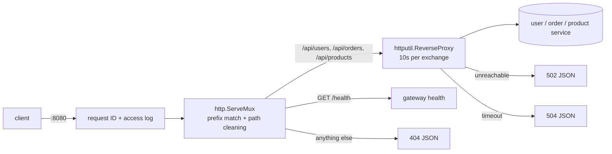

# API Gateway

Single entry point on `:8080` that forwards requests to the backend services. Go 1.22, standard library only (no `go.sum` needed).

## Run

```bash
docker compose up --build -d   # backends on :8081-8083 (from the repo root)
cd gateway && go run .         # gateway on :8080
```

## Routes

| Request | Forwarded to |
|---|---|
| `/api/users/**` | `http://localhost:8081/**` |
| `/api/orders/**` | `http://localhost:8082/**` |
| `/api/products/**` | `http://localhost:8083/**` |

The route prefix is stripped: `/api/users/1?x=1` → `http://localhost:8081/1?x=1`.
Upstreams can be overridden with `USER_SERVICE_URL`, `ORDER_SERVICE_URL`, `PRODUCT_SERVICE_URL` (e.g. `http://user-service:8080` when the gateway runs inside Docker).

## Demo

```bash
curl -s localhost:8080/api/users             # "service":"user-service","path":"/"
curl -s localhost:8080/api/orders/1001       # "service":"order-service","path":"/1001"
curl -s -X POST localhost:8080/api/products  # "service":"product-service","method":"POST"
curl -si localhost:8080/api/usersX           # 404 {"error":"no route for /api/usersX"}
curl -s localhost:8080/health                # the gateway's own health
docker compose stop order-service && curl -si localhost:8080/api/orders   # 502 {"error":"upstream unavailable"}
```

## Behaviour

- Unknown paths → `404` JSON. `/api/usersX` does not match `/api/users`.
- Paths with `..` or `//` are cleaned (redirect) before routing, so they can't reach the wrong service.
- Upstream unreachable → `502`. Each upstream exchange is limited to 10s in total: no response yet → `504`; a response still streaming at 10s is cut off (and logged with `aborted=true`). Long downloads or WebSockets would need a per-route timeout. Errors are JSON.
- Idle client keep-alive connections are closed after 60s.
- Every request gets an `X-Request-ID` (kept if the client sent one). It is forwarded upstream, returned to the client and logged (quoted, so it can't forge log fields) with method, path, status and duration.
- `X-Forwarded-For/Host/Proto` are set for upstreams; hop-by-hop headers are dropped (`httputil.ReverseProxy`).
- `SIGINT`/`SIGTERM` → stop accepting, finish in-flight requests (up to 10s), exit 0. A second signal kills it immediately.

## Design



- **Standard library only.** `httputil.ReverseProxy` already handles hop-by-hop headers, `X-Forwarded-*` and streaming. No dependencies also means no `go.sum`, which this repo gitignores.
- **`http.ServeMux` for routing.** Each prefix is registered as both `/api/users` and `/api/users/`, so the bare path isn't 301-redirected (which turns a POST into a GET in many clients) and `/api/usersX` matches neither. ServeMux also cleans `..` and `//` before matching.
- **Prefix stripped (assumption).** The services serve from `/`; forwarding the full path instead is a one-line change.
- **One deadline for the whole upstream exchange.** It also covers a body that stalls after the headers were sent. Trade-off: anything slower than 10s is cut off, so long streams would need their own timeout.
- **No panic-recover middleware.** `net/http` already recovers per request, and `ReverseProxy` aborts responses with `http.ErrAbortHandler` on purpose; the access log re-panics after logging so that still works.

## Tests

```bash
cd gateway && go test -race ./...   # unit tests, no services needed
./gateway/e2e.sh                    # end-to-end: needs the services up and :8080 free
```
