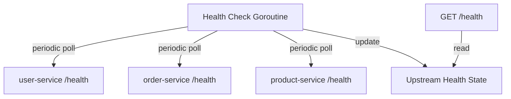
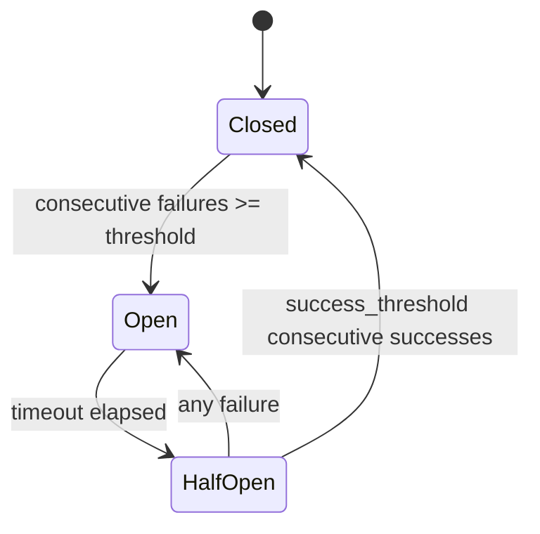

# API Gateway - Technical Specification

## 1. Overview

Implement a stateless, config-driven API Gateway in Go within the `gateway/` directory. The gateway listens on port `8080`, routes requests to 3 backend services by path prefix, and provides production-grade middleware capabilities including authentication, rate limiting, circuit breaking, and health check aggregation.

All stateful components are abstracted behind interfaces, enabling future migration from in-memory to distributed backends (e.g., Redis) without modifying business logic.

## 2. Architecture

### 2.1 Request Flow


Middleware chain order and rationale:

| Order | Middleware | Why this position |
|-------|-----------|-------------------|
| 1 | Recovery | Outermost - catches panics from all inner layers |
| 2 | Logging | Before Auth - logs all requests including rejected ones |
| 3 | Auth | Before RateLimit - rejects invalid requests early, avoids wasting rate limit quota |
| 4 | RateLimit | Before Router - global throttle applied before routing decision |
| 5 | Router | Matches prefix to upstream |
| 6 | CircuitBreaker | Per-upstream - must know target before checking breaker state |
| 7 | ReverseProxy | Innermost - actual HTTP forwarding |

### 2.2 Background Processes



A background goroutine periodically polls each upstream's `/health` endpoint and updates an in-memory health state map. The gateway's own `/health` endpoint reads this state to return an aggregated response.

## 3. Routing Rules

Config-driven. The gateway reads routing rules from `routes.yml`:

| Prefix | Upstream | Path Rewrite |
|--------|----------|-------------|
| `/api/users` | `http://localhost:8081` | Strip prefix: `/api/users/123` -> `/123` |
| `/api/orders` | `http://localhost:8082` | Strip prefix: `/api/orders/456` -> `/456` |
| `/api/products` | `http://localhost:8083` | Strip prefix: `/api/products/789` -> `/789` |

### 3.1 Path Matching

- Longest prefix match. `/api/users/profile` matches `/api/users`, not `/api`.
- Unmatched paths return `404 Not Found`.
- Matching is case-sensitive.

### 3.2 Path Rewrite

Strip the matched prefix before forwarding. This is the standard gateway behavior - upstream services should not be aware of the gateway's routing namespace.

Example: `GET /api/users/` -> upstream receives `GET /`

## 4. Middleware Specifications

### 4.1 Recovery

- Catches panics from inner handlers.
- Logs the panic with stack trace.
- Returns `500 Internal Server Error` with a generic JSON error body (no internal details leaked).

### 4.2 Logging

- Logs: method, path, status code, latency, client IP.
- Uses structured log output (`slog` from Go standard library).
- Wraps `http.ResponseWriter` to capture status code.

### 4.3 Authentication

**Interface:**

```go
type AuthResult struct {
    Authenticated bool
    Identity      string // e.g., API key owner, client name
}

type Authenticator interface {
    Authenticate(r *http.Request) (*AuthResult, error)
}
```

**Current implementation: Static API Key**

- Client sends `X-API-Key` header.
- Gateway validates against a list of allowed keys from config.
- On failure: `401 Unauthorized`.
- The `/health` endpoint is **exempt** from auth.

**Config:**

```yaml
auth:
  enabled: true
  api_keys:
    - "test-key-1"
    - "test-key-2"
```

### 4.4 Rate Limiting

**Interface:**

```go
type RateLimiter interface {
    Allow(key string) (bool, error)
}
```

**Current implementation: In-memory Token Bucket (per-IP)**

- Each unique client IP gets its own bucket.
- `rate` = requests per second allowed (sustained).
- `burst` = max burst size (bucket capacity).
- On rejection: `429 Too Many Requests` with `Retry-After` header.
- The `/health` endpoint is **exempt** from rate limiting.

**Config:**

```yaml
rate_limit:
  enabled: true
  rate: 10
  burst: 20
```

**Why Token Bucket:**
Go standard library provides `golang.org/x/time/rate` which implements token bucket. No external dependency needed (it's part of the Go extended stdlib). Clean, well-tested, and the interface allows swapping to a Redis-backed sliding window later.

### 4.5 Circuit Breaker

**Interface:**

```go
type CircuitBreaker interface {
    Execute(key string, fn func() error) error
    State(key string) State
}
```

**State machine:**



**Current implementation: In-memory, per-upstream**

Each upstream maintains independent circuit state:

| Parameter | Default | Description |
|-----------|---------|-------------|
| `failure_threshold` | 5 | Consecutive failures to trip Open |
| `success_threshold` | 2 | Consecutive successes in HalfOpen to recover |
| `timeout_seconds` | 30 | Duration of Open state before transitioning to HalfOpen |

**Behavior when Open:**
- Immediately return `503 Service Unavailable` without hitting upstream.
- Response body: `{"error": "service unavailable", "upstream": "...", "circuit": "open"}`.

**Config:**

```yaml
circuit_breaker:
  enabled: true
  failure_threshold: 5
  success_threshold: 2
  timeout_seconds: 30
```

## 5. Health Check

### 5.1 Gateway Health Endpoint

`GET /health` - Exempt from auth and rate limiting.

**Response:**

```json
{
  "status": "healthy",
  "gateway": {
    "uptime_seconds": 3600
  },
  "upstreams": {
    "user-service": {
      "status": "healthy",
      "address": "http://localhost:8081",
      "latency_ms": 2
    },
    "order-service": {
      "status": "healthy",
      "address": "http://localhost:8082",
      "latency_ms": 3
    },
    "product-service": {
      "status": "unhealthy",
      "address": "http://localhost:8083",
      "latency_ms": 0,
      "error": "connection refused"
    }
  }
}
```

### 5.2 Aggregation Logic (Three-state)

| Condition | Gateway Status |
|-----------|---------------|
| All upstreams healthy | `healthy` |
| At least one unhealthy, but not all | `degraded` |
| All upstreams unhealthy | `unhealthy` |

### 5.3 Background Polling

- Interval: every **10 seconds**.
- Timeout per health check: **3 seconds**.
- Polls each upstream's `/health` endpoint concurrently.
- Results stored in a thread-safe map (`sync.RWMutex`).

## 6. Interface Summary

All stateful components are behind interfaces for future extensibility:

| Interface | Current Impl | Future Impl | Why abstract |
|-----------|-------------|-------------|--------------|
| `Authenticator` | Static API Key | JWT / OAuth / External auth service | Auth strategy varies by environment |
| `RateLimiter` | In-memory token bucket | Redis-backed sliding window | Horizontal scaling needs shared state |
| `CircuitBreaker` | In-memory per-upstream | Redis-backed shared state | Multiple gateway instances need consistent circuit state |

## 7. Error Response Format

All error responses follow a consistent JSON structure:

```json
{
  "error": "human-readable message",
  "status": 401
}
```

No internal details (stack traces, file paths, upstream addresses) are leaked in error responses.

## 8. Config Schema (`routes.yml`)

```yaml
server:
  port: 8080

routes:
  - prefix: /api/users
    upstream: http://localhost:8081
    strip_prefix: true
  - prefix: /api/orders
    upstream: http://localhost:8082
    strip_prefix: true
  - prefix: /api/products
    upstream: http://localhost:8083
    strip_prefix: true

auth:
  enabled: true
  api_keys:
    - "test-key-1"

rate_limit:
  enabled: true
  rate: 10
  burst: 20

circuit_breaker:
  enabled: true
  failure_threshold: 5
  success_threshold: 2
  timeout_seconds: 30

health_check:
  interval_seconds: 10
  timeout_seconds: 3
```

## 9. File Tree

```
gateway/
├── main.go                    # Entry point: load config, assemble middleware chain, start server
├── go.mod                     # Go module definition
├── go.sum                     # Dependency checksums
├── config/
│   ├── config.go              # Config struct + YAML parsing
│   └── routes.yml             # Routing and feature configuration
├── middleware/
│   ├── auth.go                # Authenticator interface + API key implementation + middleware
│   ├── ratelimit.go           # RateLimiter interface + token bucket implementation + middleware
│   ├── logging.go             # Request/response logging middleware
│   └── recovery.go            # Panic recovery middleware
├── proxy/
│   ├── proxy.go               # ReverseProxy wrapper with path rewriting
│   └── circuitbreaker.go      # CircuitBreaker interface + in-memory implementation
├── router/
│   └── router.go              # Prefix-based route matching, dispatches to proxy
├── health/
│   └── health.go              # Health check handler + background upstream polling
└── Dockerfile                 # Container build for gateway
```

### Module Placement Rationale

- **`middleware/`**: HTTP-level cross-cutting concerns. Each file contains its interface, implementation, and `func(http.Handler) http.Handler` wrapper.
- **`proxy/`**: Upstream communication logic. Circuit breaker lives here because it's per-upstream, tightly coupled with the proxy decision.
- **`router/`**: Pure routing logic. Reads config, matches prefix, delegates to the correct proxy.
- **`health/`**: Separated because it has its own background goroutine lifecycle and is exempt from the normal middleware chain.
- **`config/`**: Configuration parsing. Single source of truth for all settings.

## 10. Dependencies

| Dependency | Purpose | Notes |
|------------|---------|-------|
| `gopkg.in/yaml.v3` | YAML config parsing | Widely used, stable |
| `golang.org/x/time/rate` | Token bucket rate limiter | Go extended stdlib, no external dependency |

No heavy frameworks. Standard library `net/http` + `net/http/httputil` for core HTTP and reverse proxy.

## 11. Acceptance Criteria

### Must Have (Core)

- [ ] Gateway listens on `:8080` and routes requests by prefix to correct upstream
- [ ] Path prefix is stripped before forwarding
- [ ] Unmatched routes return `404`
- [ ] Config-driven routing via YAML
- [ ] Request logging with method, path, status, latency
- [ ] Panic recovery returns 500 without leaking internals
- [ ] `GET /health` returns aggregated upstream health

### Should Have (Production-grade)

- [ ] Auth middleware with API key validation
- [ ] Rate limiting (per-IP, token bucket)
- [ ] Circuit breaker (per-upstream, 3-state)
- [ ] All stateful components behind interfaces
- [ ] Consistent JSON error responses

### Nice to Have

- [ ] Dockerfile for gateway
- [ ] Graceful shutdown (handle SIGTERM)
- [ ] Request ID propagation (generate if absent, forward to upstream)
